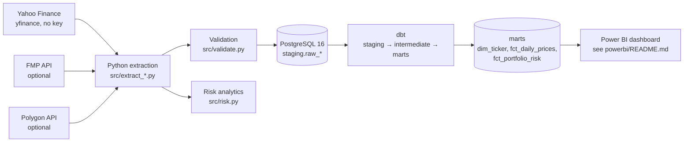

# Finance ELT Pipeline

**ELT · ETL · data pipeline · data modeling · star schema · data validation · data quality · data governance · automation**

An end-to-end **ELT pipeline** for financial market data: extract daily prices and fundamentals from REST APIs, load them raw into PostgreSQL staging, transform them with **dbt** into a **star-schema** mart, and visualise them in **Power BI**.

Built by Suranjana Aryal — MS Business Analytics (4.0 GPA, With Honors), Data Analyst at Analyze and Invest — to demonstrate the exact pipeline skills asked for in Data Analyst / Business Analyst / Power BI roles: **data pipelines, data quality and governance, data modeling, dashboards, and automation**.

## The problem

Financial analysis breaks when the data underneath it is messy: missing days, bad closes, duplicate rows, and ad-hoc spreadsheets that nobody can reproduce. This project replaces that with a repeatable pipeline:

1. **Extract** — Yahoo Finance (no key), plus optional FMP and Polygon REST APIs.
2. **Load** — raw data lands untouched in `staging.raw_prices` / `staging.raw_fundamentals` (PostgreSQL).
3. **Validate** — Python checks + dbt tests catch nulls, `close <= 0`, duplicates, and out-of-range returns before they reach a dashboard.
4. **Transform** — dbt builds `dim_ticker`, `fct_daily_prices`, and `fct_portfolio_risk` (star schema).
5. **Analyse** — risk metrics (returns, volatility, Sharpe ratio, max drawdown, inverse-volatility portfolio weights) in Python and in the marts, surfaced in Power BI.

## Architecture



Or in plain text:

```
Yahoo Finance / FMP / Polygon (REST APIs)
        ↓  Python extraction (src/extract_*.py)
   Validation (src/validate.py: nulls, close>0, duplicates, high>=low)
        ↓  Load raw — ELT
PostgreSQL 16 — staging.raw_prices, staging.raw_fundamentals
        ↓  dbt
   staging (stg_prices, stg_fundamentals)
        ↓
   intermediate (int_daily_returns)
        ↓
   marts — star schema (dim_ticker, fct_daily_prices, fct_portfolio_risk)
        ↓
Power BI (Overview / Risk / Ticker Deep Dive)
```

**ELT vs ETL:** this is deliberately ELT — raw data is loaded first, then transformed in the warehouse with dbt. That keeps the raw source of truth auditable, makes transformations version-controlled SQL, and matches how modern analytics teams (dbt + Postgres/Snowflake + Power BI) actually work. See `docs/architecture.md`.

## Data model (star schema)

| Table | Grain | Key columns |
|---|---|---|
| `dim_ticker` | One row per ticker | `ticker`, `company_name`, `sector`, `industry`, `beta`, `market_cap`, `first_price_date`, `last_price_date` |
| `fct_daily_prices` | One row per ticker per day | `ticker`, `date`, `open`, `high`, `low`, `close`, `volume`, `daily_return` |
| `fct_portfolio_risk` | One row per ticker | `ticker`, `volatility`, `sharpe_ratio`, `min/max_daily_return`, `risk_weight` (inverse-volatility) |

## Tech stack

Python, pandas, yfinance, SQLAlchemy, PostgreSQL 16, dbt, Docker, Power BI, REST APIs, pytest.

## How to run locally — 5 steps

```bash
# 1. Clone and install
git clone https://github.com/SuruCodes68/finance-elt-pipeline.git
cd finance-elt-pipeline
python -m venv .venv && source .venv/bin/activate
pip install -r requirements.txt

# 2. (Optional) add API keys — Yahoo Finance works without any key
cp .env.example .env   # fill in FMP_API_KEY / POLYGON_API_KEY if you have them

# 3. Try it offline first — no network, no Postgres needed
#    (needs only pandas/numpy; the SQLite demo load is skipped with a
#    warning if sqlalchemy isn't installed yet)
python -m src.run_pipeline --sample

# 4. Run it for real with Postgres
docker compose up -d
python -m src.run_pipeline --tickers AAPL,MSFT,NVDA,GOOGL,AMZN,SPY --start-date 2024-01-01

# 5. Build the marts with dbt, then connect Power BI
cd dbt && dbt run && dbt test
# In Power BI: Get Data → PostgreSQL → server localhost, database finance,
# tables marts.dim_ticker / marts.fct_daily_prices / marts.fct_portfolio_risk
# (full dashboard spec: powerbi/README.md)
```

## Results / metrics to expect

`--sample` mode (45 rows: AAPL, MSFT, NVDA, 2026-10-01 to 2026-10-15, synthetic demo data) prints a per-ticker risk summary and inverse-volatility portfolio weights, e.g.:

```
=== Risk summary (per ticker) ===
Ticker      Return       Vol    Sharpe    Max DD
AAPL        -0.37%    21.37%     -0.40    -6.69%
MSFT        -2.63%    22.83%     -2.17    -4.15%
NVDA         4.44%    49.98%      1.72    -8.82%

=== Risk-weighted portfolio (inverse volatility) ===
  AAPL      42.31%
  MSFT      39.60%
  NVDA      18.09%
```

Exact numbers depend on the sample/live data window. On a live run with `--start-date 2024-01-01` and all six default tickers you should expect hundreds of rows per ticker, a validated load into `staging.raw_prices`, passing dbt tests, and three populated mart tables ready for Power BI.

## Tests

```bash
python -m pytest tests/ -v
# or without pytest:
python tests/test_risk.py
```

## What to do next

- **v2 — scheduling:** orchestrate with Airflow or a cron job (see `docs/architecture.md`).
- **v2 — more sources:** add Polygon aggregates as a second price source and reconcile it against Yahoo.
- **v2 — data quality:** add Great Expectations / dbt `accepted_range` coverage for fundamentals, and alerting on validation failures.
- **v2 — warehouse:** swap Postgres for Snowflake/BigQuery by changing only the dbt profile and `DATABASE_URL`.

## Keywords

ELT, ETL, data pipeline, data modeling, star schema, data validation, data quality, data governance, data warehouse, dbt, PostgreSQL, Power BI, REST APIs, Python, SQL, automation, risk analytics.
